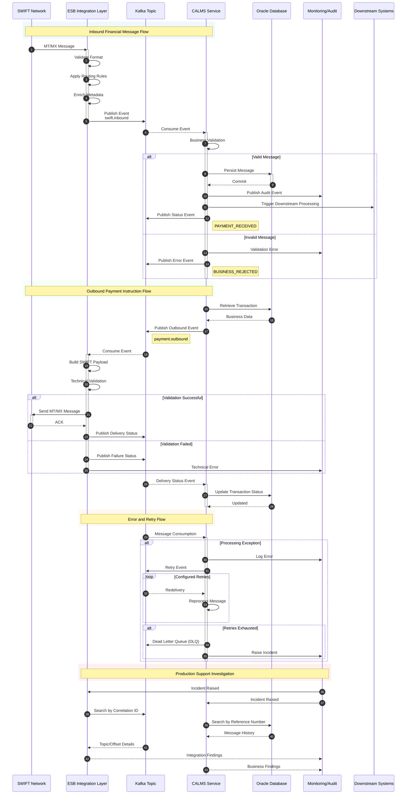
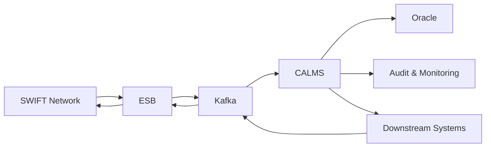
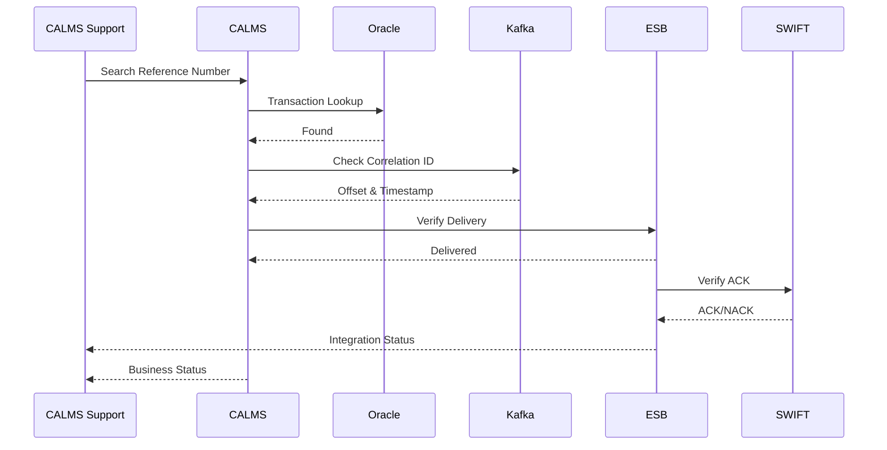

# CALMS Overview

## Purpose

CALMS is a business-critical EIB platform involved in the processing, tracking, distribution, and management of financial and operational messages

# CALMS - SWIFT / ESB / Kafka Detailed Sequence Diagram

----

----
